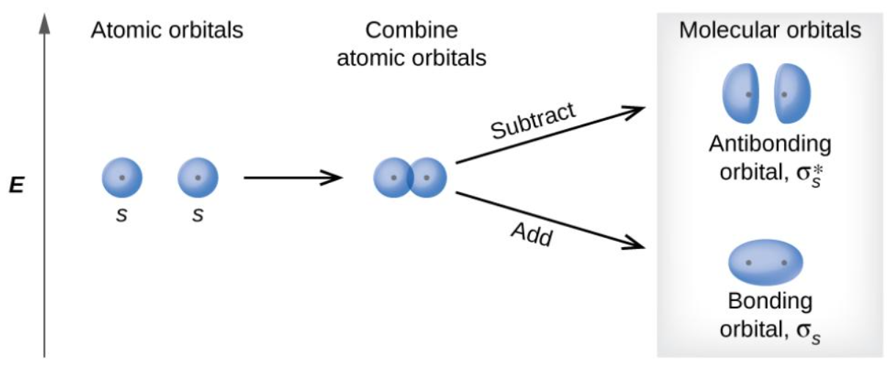
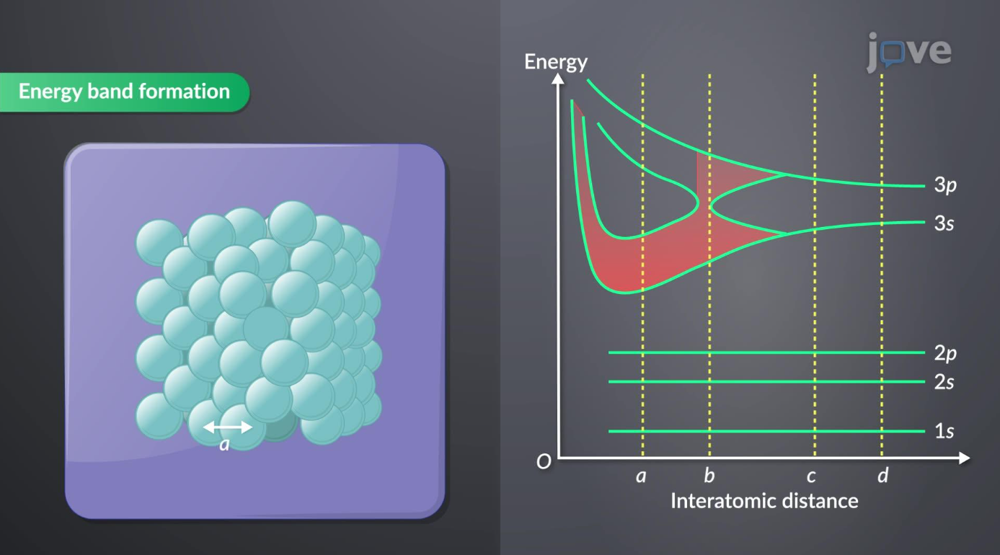
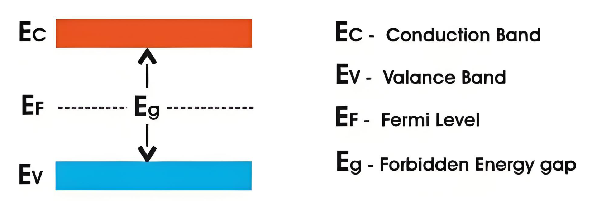
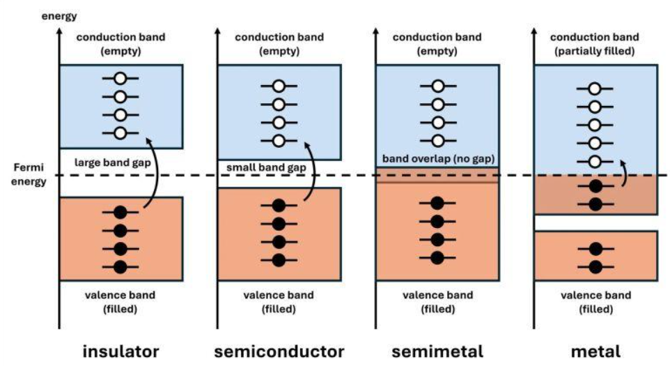
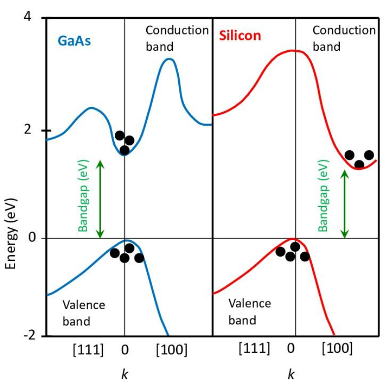

# 能级与能带（Energy Levels and Energy Bands）

半导体物理 · 01：从原子能级到固体能带，理解价带、导带、带隙与电子导电。  

## 一、为什么需要研究能级与能带？

在原子物理中，我们已经知道：原子中的电子不能具有任意能量，只能处于某些特定的能量状态。例如，氢原子的电子具有离散的能级：
$$E_n=-\frac{13.6}{n^2}\ \mathrm{eV}$$

电子可以通过吸收或释放光子，在不同能级之间跃迁。当大量原子聚集在一起，形成固体材料时，情况发生了很大的变化，原来离散的能级会发生分裂，并在一定条件下形成连续的能量区间，即能带。

能带理论是理解半导体导电、光电效应、材料能隙以及金属与绝缘体区别的基础。

## 二、从原子能级到固体能带

### 2.1 单个原子的能级

根据量子力学，电子受到原子核库仑势场的束缚，其能量只能取某些确定值。例如氢原子：
$$E_n=-\frac{13.6}{n^2}\ \mathrm{eV}$$

这里的 $n$ 是主量子数。

需要注意：

- 能级是离散的。
- 不同能级对应不同的电子量子态。
- 电子可以通过吸收或释放能量，在不同能级之间跃迁。

### 2.2 两个原子靠近时

考虑两个相同的原子,独立时各自具有原来的原子能级。  
当两个原子逐渐靠近时，它们的电子波函数开始发生重叠，两个原子之间的相互作用不能再忽略。原来能量相同的电子状态会发生分裂，形成能量略有差异的状态。  
这与量子力学中的微扰理论、简并态分裂有关。

$\text{两个一致的原子能级} \longrightarrow \text{两个相近但不同的能级}$

<!--
[File:Orbitali molecolari di legame e antilegame - schema energetico.png - Wikibooks, manuali e libri di testo liberi](https://images.openai.com/static-rsc-4/1v_YdldX9AGHDiW00GHPKNVo61LzM1uaP_gOwLbHVooqMesFPqtDcgvSxPS2W1Ut-y8vE_nBF3eAKNWiwgJotloqsqRCOl3HQzs0VrfeJ_KumnbxnMkE08PtUyB7EvwIbyUITf2x2C7N8pNEhYYb7p52yPLfyiIfxlRHGa7yCFs?purpose=inline)

[it.m.wikibooks.org](https://it.m.wikibooks.org/wiki/File%3AOrbitali_molecolari_di_legame_e_antilegame_-_schema_energetico.png?utm_source=chatgpt.com)
-->

### 2.3 大量原子组成固体

现在考虑 $N$ 个相同原子组成的晶体。随着原子之间距离减小，原来的原子能级会进一步分裂。对于一个原子能级，理想情况下可以形成 $N$ 个不同的量子态。  
当 $N$ 达到阿伏伽德罗数量级时，这些能级之间的间隔非常小。从宏观尺度看，它们几乎连续地分布在一个能量范围内，在宏观上表现为近似连续的能量区间。  
这个范围就是能带（Energy Band）。

<!--
[Energy Bands in Solids in Electrical Engineering | JoVE Core](https://images.openai.com/static-rsc-4/A-UxbUYjussvuLAkys7418ELswChgKfqEmuPbuzEsSzlU6jndyU1eKicrjn1Ncfg_8_73YSvkbbttEAntMtpjpATCYGOY9WfRmETSZyULJs8iV9tstA7ynGku72i01u_-HnklDmX5ot44HJqEhLt5UxgSOgjKhlqmHLrnceGxuM?purpose=inline)

[jove.com](https://www.jove.com/science-education/v/15151/energy-bands-in-solids?utm_source=chatgpt.com)
-->

## 三、什么是能带？

### 3.1 能带的基本定义

在晶体中，电子受到周期性晶格势场的作用。通过求解电子的薛定谔方程，可以得到一系列允许电子存在的能量区间，这些区间就是能带。  
能带内部存在大量允许的电子量子态。  
不同能带之间，可能存在不允许电子取值的能量范围。这个不允许的范围称为禁带（Band Gap）。

### 3.2 导带与价带

半导体中最重要的两个能带是：

（1）价带（Valence Band）

通常指低温下被电子占据的最高能带。  
价带中的电子通常受到晶体束缚，不能像导带电子那样自由地在晶体中运动并形成通常意义上的导电电流。

（2）导带（Conduction Band）  

位于价带之上的能带。  
电子进入导带后，通常可以在外加电场作用下改变其运动状态，从而参与导电。  
需要注意：导带电子并不是完全不受束缚，而是在晶体周期性势场中运动，其运动可以用能带结构描述。

### 3.3 禁带与带隙

价带顶部与导带底部之间的能量差称为带隙（Band Gap），通常记为：

$$ E_g=E_c-E_v $$

其中：  
- $E_c$：导带底部的能量。
- $E_v$：价带顶部的能量。
- $E_g$：带隙宽度。

带隙通常使用电子伏特（eV）作为单位。

$$ 1\ \mathrm{eV}=1.602\times10^{-19}\ \mathrm{J} $$

带隙是半导体物理中非常重要的参数，它直接影响材料吸收光子的能力、电子激发难易程度以及材料的电学性质。

<!--
[What are Energy Bands of Silicon ? - IEE-Business](https://images.openai.com/static-rsc-4/Dfsw4ITRffuiAE8CB5b1r3wWgjm1TTHZFNOca4w3gVcq4zJv1_3k23JBA_S_tQ9id_dKlPumkLYIfj2foLQlANvBKMzzGMK3D3kl5Z6PWCx_dWgOFR6SQL6I-q86WOdbpXnxWRqJBpNQAmmcnSkdgIxMC5XAVQFvOfR6b8EYHmQ?purpose=inline)

[iee-business.com](https://www.iee-business.com/knowledge/electronics-electronic-devices-energy-bands-of-silicon-1560?utm_source=chatgpt.com)
-->

## 四、能带与电子导电  

### 4.1 为什么电子进入导带就能参与导电？

回忆电磁学，带电粒子在外加电场中会受到电场力：

$$ \vec F=q\vec E $$

如果电子能够在晶体中改变自己的运动状态，就可能在电场作用下形成定向运动，从而产生电流。  
但这里有一个量子力学上的问题：

为什么价带中的电子不能像导带中的电子一样有效地参与导电？

>可以从能带中的电子占据情况理解。在理想的零温条件下：
>
>- 如果一个能带被电子完全填满，那么电子在不同运动状态上的贡献会相互抵消。
>- 如果一个能带没有被完全填满，那么电子就有可能改变自己的运动状态，形成净电流。
>
>因此，导电能力不仅取决于电子是否存在，更取决于能带的占据情况。这也是为什么金属、半导体和绝缘体具有不同导电性质的重要原因。
<!--这段写的不好理解，需要修改  --2026.11.1 -->

### 4.2 电子如何进入导带？

在半导体中，价带电子可以通过吸收能量跃迁到导带。能量来源可以包括：

- 热激发：吸收热能。
- 光激发：吸收光子。
- 电场等外部作用：在适当条件下提供能量。

例如，电子吸收一个能量足够大的光子：

$$ h\nu\geq E_g $$

其中：

- $h$：普朗克常数。
- $\nu$：光子频率。
- $h\nu$：光子能量。

电子从价带跃迁到导带后，会留下一个空缺。这个空缺称为空穴（Hole）。  
于是，半导体中产生了一对载流子：

- 导带中的电子。
- 价带中的空穴。

空穴可以近似理解为一个带正电的准粒子，它能够参与导电。

## 五、金属、半导体与绝缘体的能带区别

*导体，半导体，准金属与金属*
<!--
[#physics #solidstatephysics #bandtheory #semiconductors #metals #insulators #semimetals #materialscience | Kai Wenz, PhD](https://images.openai.com/static-rsc-4/C0wR2K3oYdvnd_h_2BlKOSW9GbFRPbJDTcnPWoDT612_wwZTcO9D93ijHFTRl5HC6vEnNkVL4lyorFLQvU57h-jipbYaNP_VmO-qgf4ohxL77HxZBKBRKfKQf-HG_xLU-J6j_2BLG9azWsC4RZnwZzv_RbJygBCABx0QLtBLsoo?purpose=inline)
-->
1\. 金属（Metal）

通常存在部分填充的能带，或者价带与导带发生重叠。电子很容易在附近找到可占据的不同能量状态，因此能够在电场作用下形成电流。

2\. 半导体（Semiconductor）

价带与导带之间存在较小的带隙。在一定温度或光照条件下，电子可以获得足够能量跃迁到导带，产生电子和空穴。  

3\. 绝缘体（Insulator）

价带与导带之间通常存在较大的带隙。在普通条件下，电子难以获得足够能量进入导带，因此导电能力较弱。

注意：

金属、半导体和绝缘体的区别并不是严格由某一个固定带隙数值划分的，还与能带占据情况、温度、材料结构等因素有关。

## 六、能带与波矢：为什么能带结构通常画成 $E-k$ 图？

能带图，主要展示的是能量范围。而能带结构图（Band Structure）表示电子能量与波矢之间的关系。

### 6.1 波矢是什么？

回忆量子力学中的平面波：

$$ \psi(\vec r)=Ae^{i\vec k\cdot\vec r} $$

其中 $\vec k$ 是波矢。

根据德布罗意关系：

$$ \vec p=\hbar\vec k $$

因此，波矢与电子的晶体动量密切相关。在晶体中，由于周期性势场的存在，电子的能量不仅取决于它的运动状态，也与波矢有关。于是我们可以得到：

$$ E=E(\vec k) $$

### 6.2 能带结构图怎么看？

<!--
[반도체의 재발견: 모스펫 발명에서 유기 반도체까지 – 고등과학원 HORIZON](https://images.openai.com/static-rsc-4/VvJ5asotFvbs48ntN236evr_RhCPbhpclaJqhJyO2HWzO9gCUcjew6v7LZoveYc4GrTyhjO3HKUhHxLr28ZNeEAvWjamSgfy2dmyFgXYFC9dP4iE4tPT1O2rdz4rC7_qo96eEr2d-dNkOiDx1g9rYZsQh6xODYLMPEp9WvbW9qY?purpose=inline)

[horizon.kias.re.kr](https://horizon.kias.re.kr/18687/?utm_source=chatgpt.com)
-->
图中：  
横轴：波矢 $k$。 （也就是动量）  
纵轴：电子能量 $E$。  
曲线：不同能带的能量随波矢变化的关系。  

直接带隙（Direct Band Gap）：导带最低点与价带最高点出现在相同的波矢位置。电子跃迁时，通常不需要额外改变晶体动量，因此可以直接通过吸收或发射光子完成跃迁。  
间接带隙（Indirect Band Gap）：导带最低点与价带最高点出现在不同的波矢位置。电子跃迁时，除了能量变化，还需要满足晶体动量守恒，通常需要声子参与。

这会影响材料的光吸收和发光效率，例如图中的GaAs（直接带隙半导体）和Si（间接带隙半导体）。这也是为什么硅虽然在集成电路中非常重要，却不是高效率发光器件的理想材料。
<!--这里不是特别清楚，需要晶格动量与波矢等相关前置知识 -->
## 七、术语表

| 概念   | 英文              | 核心含义             |
| ---- | --------------- | ---------------- |
| 能级   | Energy Level    | 电子允许具有的特定能量      |
| 能带   | Energy Band     | 大量允许能量状态形成的能量区间  |
| 价带   | Valence Band    | 通常为低温下最高的已占据能带   |
| 导带   | Conduction Band | 电子可以参与通常意义上导电的能带 |
| 禁带   | Forbidden Band  | 不存在允许电子态的能量区间    |
| 带隙   | Band Gap        | 导带底与价带顶之间的能量差    |
| 空穴   | Hole            | 价带中电子缺失所形成的准粒子   |
| 波矢   | Wave Vector     | 描述波的空间变化，关联晶体动量  |
| 能带结构 | Band Structure  | 电子能量与波矢之间的关系     |

## 八、知识之间的逻辑关系回顾

单个原子的离散能级 ->   
原子相互作用与能级分裂,大量密集的允许电子态，能带形成（价带、导带与带隙） ->   
电子状态与跃迁条件，半导体的电学与光学性质
<!--
## 九、与后续半导体知识的联系

学习能级与能带后，已经具备理解以下概念的基础：

1. 费米能级（Fermi Level）：电子在热平衡状态下占据不同能量状态的统计规律如何描述？费米能级在能带中处于什么位置？
2. 费米能级钉扎（Fermi Level Pinning）：为什么金属与半导体接触后，费米能级的位置不一定按照简单的理论预期变化？
3. 本征半导体与掺杂半导体：杂质原子如何改变半导体中的电子状态？
4. 载流子浓度：如何利用统计物理计算导带电子和价带空穴的数量？
5. 能带弯曲（Band Bending）：为什么半导体表面或界面处的能带会发生弯曲？

其中，前两项与你正在接触的半导体界面研究尤其相关。

本篇最重要的结论：

能带理论本质上是将量子力学应用于周期性晶体结构的结果。原子能级在大量原子相互作用下形成能带，而能带的结构、占据情况以及能带之间的能量差，共同决定了材料的许多电学和光学性质。

后续学习建议沿着「能带 → 费米能级 → 载流子统计 → 半导体界面」这条主线展开。
-->