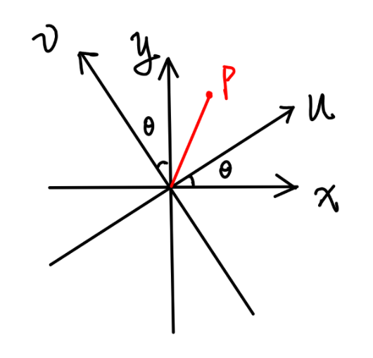

# 关于简正模式的一些理解

此文旨在用粗糙但易于理解的方式，通过线性代数的语言，说明简正坐标是怎么导出来的，以及由此得到的一些结论。

（注：在简单情形下，所涉及的矩阵总是实对称的，因此这里先从正交坐标系讲起。）

## 一、从坐标变换说起

*图 1：原坐标系 $x$-$y$ 与旋转 $\theta$ 后的新坐标系 $u$-$v$，红点为 $P$。*

如图所示，原坐标系为 $x$-$y$ 系，在它的基础上引入新坐标系 $u$-$v$。关于这两个系，我们最关心的问题是：原来 $x$-$y$ 系中的一个点（向量），放到 $u$-$v$ 系下该如何表述，也就是坐标变换关系是什么。

如图中的 $P$ 点，它在 $x$-$y$ 系中表示为 $(x_0,y_0)$，也可以写成矢量形式

$$\vec{OP}=x_0\hat{x}+y_0\hat{y}.$$

在 $u$-$v$ 系中，它则表示为 $(u_0,v_0)$，其中

$$u_0=\vec{OP}\cdot\hat{u}=x_0\,\hat{x}\cdot\hat{u}+y_0\,\hat{y}\cdot\hat{u}=x_0\cos\theta+y_0\sin\theta.$$

同理可得

$$v_0=\vec{OP}\cdot\hat{v}=x_0\,\hat{x}\cdot\hat{v}+y_0\,\hat{y}\cdot\hat{v}=-x_0\sin\theta+y_0\cos\theta.$$

若记 $x_u=\hat{x}\cdot\hat{u}=\cos\theta$，$y_u=\hat{y}\cdot\hat{u}=\sin\theta$，$x_v=\hat{x}\cdot\hat{v}=-\sin\theta$，$y_v=\hat{y}\cdot\hat{v}=\cos\theta$，就有 $u_0=x_u x_0+y_u y_0$，$v_0=x_v x_0+y_v y_0$。用矩阵来描述就是

$$\begin{bmatrix}u_0\\v_0\end{bmatrix}=\begin{bmatrix}x_u&y_u\\x_v&y_v\end{bmatrix}\begin{bmatrix}x_0\\y_0\end{bmatrix}.$$

记这个坐标变换矩阵为 $S$。它的每一列，就是原坐标系一个单位向量在新系下的坐标。由此可见，把 $x$-$y$ 系下的坐标变换到 $u$-$v$ 系，只需在 $x$-$y$ 坐标的列向量左边乘上 $S$。

现在在 $u$-$v$ 系下做一个简单的变换：把 $u$ 坐标变成 $\lambda_1$ 倍，$v$ 坐标变成 $\lambda_2$ 倍，写成矩阵是

$$\begin{bmatrix}u'\\v'\end{bmatrix}=\begin{bmatrix}\lambda_1&0\\0&\lambda_2\end{bmatrix}\begin{bmatrix}u_0\\v_0\end{bmatrix}.$$

这个变换在 $x$-$y$ 系中如何表示？思路很自然：先把 $x$-$y$ 中的坐标换到 $u$-$v$ 下，做完伸缩再换回来。写成矩阵就是

$$\begin{bmatrix}x'\\y'\end{bmatrix}=\begin{bmatrix}u_x&v_x\\u_y&v_y\end{bmatrix}\begin{bmatrix}\lambda_1&0\\0&\lambda_2\end{bmatrix}\begin{bmatrix}x_u&y_u\\x_v&y_v\end{bmatrix}\begin{bmatrix}x_0\\y_0\end{bmatrix}.$$

上式右边的第一个因子正是 $S^{\mathrm{T}}$，中间的伸缩矩阵记为 $\Lambda=\operatorname{diag}(\lambda_1,\lambda_2)$，于是这个变换的矩阵可以写成 $S^{\mathrm{T}}\Lambda S$。又因为 $S$ 是正交矩阵，$S^{-1}=S^{\mathrm{T}}$，所以它也等于 $S^{-1}\Lambda S$。

于是我们自然会想：如果一个问题（一种变换）能找到一个可以简单描述的坐标系，是不是就会变得容易解决？比如一个看起来很奇怪的变换，在新系下只是一个简单的伸缩变换。答案当然是肯定的。

## 二、振动方程

现在来到力学问题。一个振动体系的拉氏量写作

$$L=\frac{1}{2}\dot{Q}^{\mathrm{T}}M\dot{Q}-\frac{1}{2}Q^{\mathrm{T}}KQ.$$

代入拉格朗日方程。这里用到一个小结论：$F=X^{\mathrm{T}}AX$ 的微分为

$$\mathrm{d}F=\mathrm{d}X^{\mathrm{T}}AX+X^{\mathrm{T}}A\,\mathrm{d}X=X^{\mathrm{T}}\left(A^{\mathrm{T}}+A\right)\mathrm{d}X,$$

因此 $\partial F/\partial X=\left(A+A^{\mathrm{T}}\right)X$。又因为 $M$ 和 $K$ 都是实对称的，转置等于自身，故可得方程

$$M\ddot{Q}+KQ=0.$$

关于这个方程，一般的做法是设待定系数再求解，但这样做只能说完成了一道计算题。下面来深入看看简正坐标背后的东西。

在我们研究的体系里，$M$ 和 $K$ 总是实对称且正定的。这两个性质很关键，简正坐标的存在也依赖于此。矩阵描述空间的变换，而实对称矩阵描述的变换可以等效为若干个正交方向上的伸缩，不包含剪切之类的成分。为了方便理解，接下来的讨论都基于三维空间，但结论并不局限于三维。

## 三、同时对角化

先设想一下：对于方程 $M\ddot{Q}+KQ=0$，如果存在一种变换 $Q=Tq$，代入后得到 $MT\ddot{q}+KTq=0$，再左乘 $T^{\mathrm{T}}$，就得到

$$T^{\mathrm{T}}MT\,\ddot{q}+T^{\mathrm{T}}KT\,q=0.$$

如果 $M'=T^{\mathrm{T}}MT$ 和 $K'=T^{\mathrm{T}}KT$ 都是对角矩阵，方程中不再有耦合项，问题就解决了。于是剩下两个问题：这样的变换存在吗？如果存在，又该怎么找？

先看第一个问题。答案仍然落在 $M$ 和 $K$ 的实对称与正定性上。在这个问题里，$M$ 和 $K$ 的地位是对等的：要求把 $M$ 对角化的同时把 $K$ 也对角化，与反过来做是同一件事。不妨先看 $M$。

$M$ 实对称，因此存在正交矩阵 $R$，使得

$$M=R\Lambda R^{\mathrm{T}},\qquad RR^{\mathrm{T}}=E,$$

其中 $\Lambda=\operatorname{diag}(\lambda_1,\lambda_2,\lambda_3)$，$E$ 是单位矩阵。又因为 $M$ 正定，所以 $\lambda_1,\lambda_2,\lambda_3>0$。设

$$B=R\Lambda^{-1/2},\qquad \Lambda^{-1/2}=\operatorname{diag}\left(\lambda_1^{-1/2},\lambda_2^{-1/2},\lambda_3^{-1/2}\right),$$

便有

$$B^{\mathrm{T}}MB=\Lambda^{-1/2}R^{\mathrm{T}}R\,\Lambda R^{\mathrm{T}}R\,\Lambda^{-1/2}=\Lambda^{-1/2}\Lambda\Lambda^{-1/2}=E.$$

也就是说，一定存在一个矩阵 $B$，把 $M$ 化成单位矩阵。

对方程 $M\ddot{Q}+KQ=0$ 先做 $Q=By$ 的变换，得到

$$E\ddot{y}+K'y=0,\qquad K'=B^{\mathrm{T}}KB.$$

此时 $K'$ 仍然是实对称矩阵（后面会从几何上解释）。再做一次正交变换 $y=Dq$，其中 $D^{\mathrm{T}}D=E$，$D^{\mathrm{T}}K'D=\Lambda_K$，便得到

$$E\ddot{q}+\Lambda_K q=0.$$

这里的 $\Lambda_K$ 就是以 $\omega^2$ 为对角元的矩阵。

以上过程也可以反过来：先把 $K$ 化为单位矩阵，再对角化 $M$，同样成立。于是第一个问题解决了。

## 四、求简正坐标

既然理论上已经证明 $M$ 和 $K$ 可以同时对角化，那么如何把这个变换求出来？其实只需要解方程

$$MX=\lambda KX.$$

它的含义是：存在一些非零向量 $X$，$M$ 作用在它上面与 $K$ 作用在它上面，结果只差一个倍数 $\lambda$。要使非零的 $X$ 存在，只需要

$$\det\left(M-\lambda K\right)=0.$$

由此解出一系列 $\lambda$，分别代回方程，就能得到对应的几组 $X$ 各分量之间的比例关系。之所以只有比例而没有具体数值，是因为我们求的本质上是一些特殊的方向：沿这些方向，已知变换可以只用伸缩来描述。把这些只知道方向的向量都取为单位长度，它们就构成一个新系的基，这个新系就是简正系。

回到最开始的图，我们相当于已经知道了新基在原坐标系下的分量，于是可以写出变换

$$\begin{bmatrix}Q_1\\Q_2\\Q_3\end{bmatrix}=\begin{bmatrix}x_{11}&x_{21}&x_{31}\\x_{12}&x_{22}&x_{32}\\x_{13}&x_{23}&x_{33}\end{bmatrix}\begin{bmatrix}q_1\\q_2\\q_3\end{bmatrix},$$

简正坐标则是

$$\begin{bmatrix}q_1\\q_2\\q_3\end{bmatrix}=\begin{bmatrix}x_{11}&x_{21}&x_{31}\\x_{12}&x_{22}&x_{32}\\x_{13}&x_{23}&x_{33}\end{bmatrix}^{-1}\begin{bmatrix}Q_1\\Q_2\\Q_3\end{bmatrix}.$$

这里 $q_1,q_2,q_3$ 就是简正坐标，每一个都对应一个独立的振动模式。因为此时每个简正坐标都满足 $\ddot{q}_i+\lambda_i q_i=0$，所以 $\lambda_i$ 就是对应模式圆频率的平方，即 $\lambda_i=\omega_i^2$。至此，问题已经解决。

## 五、几何解释

上面的代数推导可能仍然不容易理解，下面换一个视角。把 $M$ 和 $K$ 都去量纲化，各自剥离出一个单位，分别归入 $\ddot{Q}$ 和 $Q$，使乘积仍然具有广义力的量纲。于是问题变成：存在两个变换矩阵，分别作用在 $\ddot{Q}$ 和 $Q$ 这两个向量上，得到两个新向量，而物理定律告诉我们这两个向量加起来为零。这其实就是达朗贝尔原理。

我们已经知道，描述这两个变换的矩阵 $M$ 和 $K$ 都是实对称正定的，因此每个变换都能拆成三个正交方向上的正缩放。以这些缩放倍率为半轴长，可以得到两个椭球。当然，这两个椭球的主轴通常并不平行。

如果能变换空间，让两个椭球的所有主轴都平行就好了。做法是：在第一个椭球的基础上，沿它的三条主轴做伸缩，把它变成一个完美的球；第二个椭球跟着做同样的变换，由于只做了伸缩，它仍然是椭球。之所以如此，是因为伸缩作用在椭球上仍然是椭球：把这次伸缩沿该椭球当前的三条主轴分解，每个方向只是改变半轴的长度，不会破坏椭球的形状。这也顺便解释了为什么 $K'$ 仍然是实对称矩阵。

现在有了一个球和一个椭球。球的主轴可以任取，于是总能让两个椭球的主轴方向一致。再旋转坐标系，让椭球正放，得到的新系就是简正系。这两步正好对应前面的数学推导：先把第一个椭球拉成球，第二个椭球同步变化，然后旋转坐标系。

由于球体的半径是 1，最后得到的椭球的三条半轴长正好是 $\omega_1^2,\omega_2^2,\omega_3^2$。

至此，整个流程在几何上也说通了。
