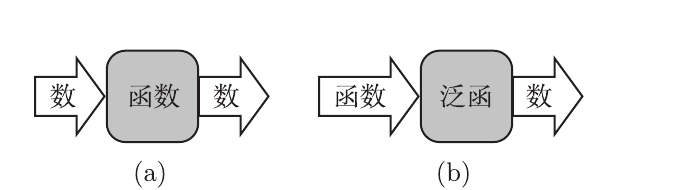
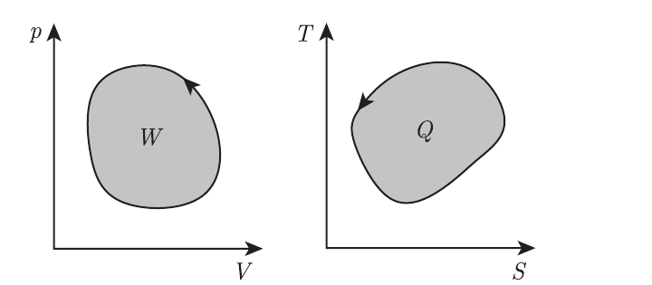
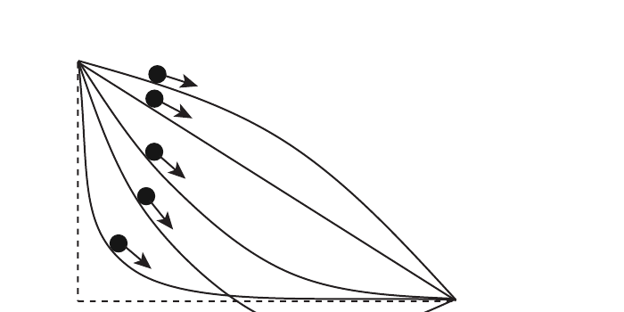

# 泛函

为了解释泛函，有必要先回顾函数.形象地说，函数像一台机器：输入一个数，输出另一个数.这里的“数”可以是实数、复数、数组、向量或矩阵等.

*函数与泛函*

数学化地讲,函数就是一种映射关系.给定集合 $X$ 与 $Y$，在两个集合地元素之间建立一个对应关系即映射,

$$
f:\quad t\mapsto y=f(t)
\tag{1.1}
$$
而这个映射关系的具体形式就是函数.在往后的物理学习中,会遇到大量的概念,都可以认为是一种映射.

## 泛函的概念

对于一个映射,考虑的是其输入与输出的对应关系.在一些例子中,普通函数的映射关系不足够使用.例如：

  - 空间中任意两点以曲线连接,给定曲线形状(输入),得到曲线的长度(输出)；
  - 给定热力学准静态循环过程(输入)，由 $p$--$V$ 图围成的面积算出系统做功(输出)；
  - 给定两端固定的光滑轨道，由轨道形状(输入)算出小球下落所需的时间(输出).

*准静态循环过程*

*最速下降曲线问题*

这些例子的输出是“数”，输入却是曲线、曲面、轨道形状或准静态过程等,都不是普通的数.因此,为了描述并解决此类问题,需要推广普通函数的概念.
我们发现,以上例子中,输入都可以使用函数描述.因此,引出泛函(functional)的概念.
形象地说,泛函也像一台机器：输入一个函数，输出另一个数.
用数学语言描述,泛函即为函数到数的映射.在此前的普通函数例子中,集合$X$与$Y$有许多种函数$y=f_1(x),y=f_2(x),y=f_3(x),etc$,所有的这些函数构成了一个集合$\mathcal{F}={f_1,f_2,f_3,...}$
该集合的元素即为一个函数.函数$f$的泛函$\mathcal{S}$可记为:

$$
f\mapsto S=S[f],\qquad \mathcal F\to\mathbb C.\tag{1.2}
$$
总之,可以认为泛函是一种广义的函数,只不过普通函数是"数的函数"，而泛函则是"函数的函数".

以下给出一些泛函的例子:

  -经典力学:作用量
  给定给定一条粒子运动轨迹 $q(t)$，作用量是
  $$
  S[q]=\int_{t_1}^{t_2} L\bigl(q(t),\dot q(t),t\bigr)\,\mathrm{d}t
  $$
  -量子力学:能量平均值
  给定量子态$\psi$与算符$\hat{H}$,能量平均值是
  $$
  E[\psi]=\langle\psi|\hat{H}|\psi\rangle
    =\int \psi^*(\mathbf{r})\,\hat{H}\psi(\mathbf{r})\,\mathrm{d}^3r
  $$
