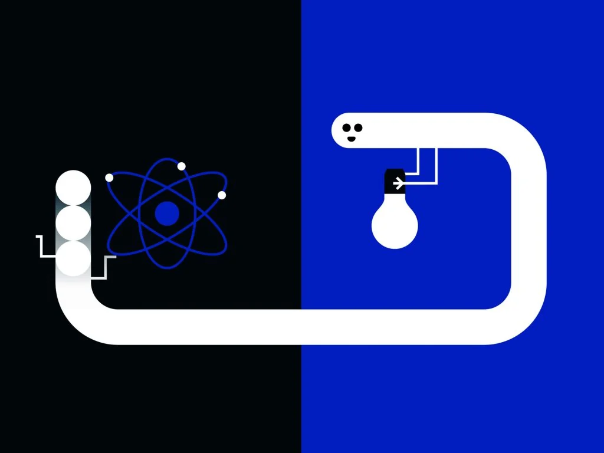

# 2025物理诺贝尔奖：隧穿效应，约瑟夫森结与量子计算

物理学大多数理论是决定论。仿佛我们人类的生活，乃至宇宙之后的结局，在宇宙诞生时就已注定。用概率描述物理规律的，一个是热学，它通过事物总是朝概率大的方向发展，规定了时间之矢的方向。它虽然给一些仍有一定概率发生的事留出空间，但毕竟只是一个统计学规律。另一个就是量子力学，它在最底层的物理规律中留出不确定性，神秘而有魅力。我有时会想，人类大脑一念之间的决定是否和这两个规律有关。

> “从认识的层面看，经典理论属于决定论，而量子理论属于概率论，实际上，决定论只是概率论的一个特例。”
>
> ——《量子计算与量子优化算法》，李士勇、李盼池

随机性本身就是一个很奇妙的概念，我觉得它与对称性也有密不可分的联系，这从量子力学的表述就能窥见。我们说一个处于量子态的粒子经过观测后就会坍缩成一个确定的状态。电子双缝干涉实验中，电子并不表现出偏爱两个狭缝中的任何一个，此时它仿佛处于一个山丘的顶端，两边分别是射入其中一个狭缝的状态。电子发射后，它就仿佛从尖端落下，随机落入其中的一个。我觉得对称性体现了宇宙的“平等性”，对各个状态一视同仁。有趣的是，宇宙的每一条对称性都对应一个守恒律。

1925 年是量子力学的“奇迹年”，标志着旧量子论的结束和现代量子力学的正式诞生。1925 年，海森堡开创矩阵力学，乌伦贝克与古兹米特提出电子自旋。薛定谔的波动力学、玻尔的互补原理也在后两年陆续提出。一百年后，诺贝尔奖再度颁给量子力学领域，这是一种独特的致敬。

其实隧穿效应早在 1920 年就在薛定谔关于禁带波函数的推导中被发现了。乔治·伽莫夫、罗纳德·格尼与爱德华·康登利用隧穿理论解释 $\alpha$ 衰变，并推算半衰期，与实验完全吻合。1957 年，利用隧道效应的隧道二极管被发明（江崎玲于奈也因此获得 1973 年诺贝尔物理学奖）。海因里希·罗雷尔和格尔德·宾宁因发明了通过测量隧道电流工作的扫描隧道显微镜，获得 1986 年诺贝尔物理学奖。

那么，2025 年得奖的成果新在什么地方呢？首先是尺度：微观粒子的量子行为在一百年前就已被确认，但宏观的量子现象，比如说一只薛定谔的猫，从来没有被观测到过。约翰·克拉克（John Clarke）、米歇尔·德沃雷（Michel Devoret）和约翰·马丁尼斯（John M. Martinis）在两块超导体之间夹上一层超薄的绝缘体，制成了约瑟夫森结。他们在宏观尺度的电路中，清晰地观测到原本只属于微观世界的量子现象。

## 一、隧穿效应

能够发生衍射，是物质粒子的普遍性质。衍射的本质是两道波的相干：在某些同相的地方叠加，在某些反相的地方相消。那么，用波函数来描述粒子也就是一个自然的想法：波的相位决定干涉，波的振幅的平方则对应粒子出现的概率。三角函数的叠加能很好地描述粒子的相干叠加性（态叠加原理）。但粒子出现的位置仍具备一定的确定性，总在一定区域内，所以不能用无限延展的 $\sin$ 函数描述，而应该利用傅里叶变换，用三角函数叠加出波包比较集中的函数来描述。波包函数绝对值的平方可以示意粒子出现的概率，且 $P=A^2V$。

对于经典的情形，比如一个初动能较小的小球想要滚过一个山丘，如果山丘顶端的重力势能比它的初动能要大，那么这个作为障碍物的山丘就能挡住这个小球，小球不可能翻过山，无论做多少次实验，没有任何一次小球会翻过去（此处忽略小球内能在极小极小极小概率下自发有序化转化为动能的概率）。而想象一个水波，水波的前方出现一个水位计（一根扎进水底的长杆），挡住了水波的前进，水波并不会被完全挡住，而是会通过衍射越过障碍，只是在越过障碍后，波的能量会发生损耗。

当对象变为一个微观粒子，面对一个势垒时，比如说原子核的电磁斥力形成的势垒（barrier，障碍），它的动能本来不足以让它逃逸，然而波函数的性质使得它在势垒外仍有一定的出现概率，只是变小了一点。仿佛发生了衍射一样，然而原子核的电磁力势垒显然是没有“缝隙”的，所以微观粒子仿佛在势垒中找到了一条隧道一样，这样的效应就叫作隧穿效应。在这次获得诺奖的实验中，这个势垒就是夹在超导体中间的一层超薄绝缘体。如果没有隧穿效应，那么绝对不可能形成电流，但实验得到了电流，从而在较宏观的尺度上测量到了隧穿效应。

隧穿效应十分神奇。物质波毕竟不是水波：障碍挡住了水波，却没有挡住介质（宽阔的水面延伸到了障碍身后），所以水波才能通过介质绕过障碍；如果把障碍换成将水面隔断的真空，哪怕只是很薄的一层，水波也无法绕过。

目前我理解的波函数还仅限于一个模型，它在现实中有没有可观测的实在呢？就像引力场实际是时空的弯曲，电磁场也是有可观测的实体的（光子）。波函数只是概率幅，没有介质，它是如何完成隧穿的？是不是电磁势垒其实并不是“致密”的，而是有“缝隙”的呢？又或者，回到“量子”这个词，也许宇宙的运行也是有最小“加载单位空间”的，而宇宙的加载没那么精确，导致了隧穿效应？
<!--

*图片来源于网络*-->

## 二、量子计算

我们经常听说量子计算机更快，是因为量子比特能同时处于几个状态，并行执行几种运算。前者听起来很奇怪，而后者听起来，经典计算机似乎也不是做不到。量子比特和经典比特的区别到底在哪？量子算法的优势在哪里？量子计算机真的如媒体吹嘘的那般神通广大吗？

香农开创了信息论，从此信息成了可以量化衡量的东西。我们每天从课堂、书籍、新闻得到的“信息”到底是什么呢？香农告诉我们，它们是用来消除不确定性的。抛一个硬币，硬币静置后低头看一眼，让你得知了抛硬币这一随机过程的确定结果。战时，敌方会从哪路进攻是个不确定的事件，而情报带来的信息消除了这一不确定性。衡量信息量的物理量“自信息” $I(x)$ 应运而生：

$$I(x)=-\log_b P(x).$$

其中，$P(x)$ 是事件发生的概率，$b$ 是对数的底数。当 $b=2$ 时，信息量的单位是比特（bit），它描述了这个信息为我们消除了多少随机性。

经典计算机中，用高低电平来表示 $1$ 和 $0$。两个经典比特有四种可能（00、01、10、11），每个结果出现的概率都是 $1/4$。而电脑储存的信息 10（二进制中的 2），每一位都为我们消除了一半的不确定性。即两个经典比特为我们提供两比特的信息。

而量子计算机所谓的叠加态，其实就是概率叠加。想象一个原子，它的电子有 $p$ 的概率不跃迁，有 $1-p$ 的概率跃迁。那么此时它所代表的量子比特就有 $p$ 的概率是 $0$，有 $1-p$ 的概率是 $1$。量子计算中将其表示为

$$\alpha|0\rangle+\beta|1\rangle,$$

其中

$$\alpha^2=p,\qquad \beta^2=1-p.$$

量子计算机的运算结果通过测量原子的跃迁情况来得出。

量子算法并不对储存的 $0$ 和 $1$ 本身进行运算操作，而是通过算法改变出现 $0$ 和 $1$ 的概率（即 $\alpha$ 和 $\beta$），这使得两个量子比特能同时表示 4 种状态。经典算法只能在相邻状态之间进行计算摸索，而量子算法的这种操作就仿佛走了斜线，从而减少了运算量和运算时间；减少的程度正如同它“走斜线”和“走直线”的路程比，是经典运算次数的平方根。所以有观点认为，量子计算机在大部分情况下的表现比不上经典计算机，而只是在暴力破解上有点特长。
<!--

*图片来源于网络*-->

## 三、约瑟夫森结：人造原子

直接使用原子，无论是控制还是测量，当然都极其不容易，所以使用约瑟夫森结来模拟原子是当今的主流技术。

约瑟夫森结是将两个超导体用一层超薄的绝缘体隔开形成的结构。在极低温下，超导体中的电子成对地结合在一起，形成库珀对，行为也变得统一起来，表现出宏观量子效应。1962 年，布莱恩·约瑟夫森预言超导体中形成的库珀对可以隧穿绝缘层形成的势垒，即使没有电压，也可以形成超导电流。约瑟夫森因为这个预言获得 1973 年诺贝尔物理学奖。

根据约瑟夫森的理论，当结两端外加电压为 $0$ 时，超导电流只与势垒两边波函数的相位差有关，即第一方程：

$$I=I_c\sin\delta.$$

第二方程则给出电压与相位差的关系：

$$V=\frac{\hbar}{2e}\frac{\mathrm{d}\delta}{\mathrm{d}t}.$$

当结两端加恒定电压时，相位差 $\delta$ 会随时间线性增长。将线性增长的 $\delta$ 代回第一方程，可以发现，此时电流变成了正弦交流电。

现在，我们把电容效应考虑进来，得到完整的电路方程：

$$I=I_c\sin\delta+C\frac{\mathrm{d}V}{\mathrm{d}t}.$$

利用第二方程，我们可以将上述电路方程改写为：

$$I=I_c\sin\delta+\left(\frac{\hbar}{2e}\right)C\frac{\mathrm{d}^2\delta}{\mathrm{d}t^2}.$$

变形得到

$$I-I_c\sin\delta=\frac{\hbar C}{2e}\ddot{\delta}.$$

类比牛顿第二定律：

$$F=m\ddot{x}.$$

此时的 $\delta$ 就是 $x$，$F$ 就是 $I-I_c\sin\delta$。通过类比可以看出，这是一个保守力的形式，积分得出它的势能函数为：

$$U(\delta)=-I_c\cos\delta-I\delta.$$

看得出来，势垒 $U(\delta)$ 可以通过电流 $I$ 来调节，从而调节波函数，进一步调节这个量子比特的状态（出现 $0$ 或 $1$ 的概率，即 $\alpha$ 和 $\beta$）。

另一方面，也可以直接通过微波辐射改变库珀对载流子的能量，从而改变概率幅分布，改变隧穿发生的概率。

至此，我们就从理论上得到了能垒可调节、能级可控制的“人造原子”。
<!--

*图片来源于网络*-->

## 四、一系列开创性实验

而这次的诺奖，正是颁给了对这一理论的验证和实验。

首先，他们通过精妙的设计和精密的仪器排除了环境黑体辐射的干扰，保证了超导电流来自隧穿效应而不是外来能量。接着，他们先使用微波激发电路，得到势阱深度等相关参数，依据宏观量子隧穿理论计算预测逃逸率。然后在低于经典–量子交叉温度的条件下，测量结从零电压态逃逸的速率，得到的逃逸率与预测完美吻合。这证明了超导电流的产生（结的激发）来自量子隧穿效应而非热激发。

在以上实验的基础上，他们还进行了更具开创性的探索。他们通过设置不同的偏置电流，改变了结的“势阱形状”，即这个模拟原子的“能级间距”，并施加一定频率的微波来给这个人工原子注入大小不等的能量。通过对照，他们又得到了几个关键发现：一是当微波频率逐渐加大时，逃逸率并不是均匀增大，而是一系列分离的峰，这直接说明了约瑟夫森结这个宏观电路拥有离散的、量子化的能级。更加优雅的是，这个结的能级行为与一个具有离散能级的量子粒子一模一样。

总之，这些实验无可置疑地证明，一个“大到可以用脏手触摸”的超导电路，能够“被足够好地隔离，以观察宏观自由度的能量量子化以及从亚稳态发生的宏观量子隧穿”。这些成果为在超导电路中探索宏观量子物理奠定了基础，其中约瑟夫森结扮演了工程化人造原子的角色。另一方面，这些成果也为开发下一代量子技术提供了机会，包括量子密码学、量子计算机和量子传感器。

## 五、后记：有趣的物理学家们

在约瑟夫森结这个电路中，因为公式结构的统一，我们成功用电路模拟了原子。它不通过复杂的计算机程序，而是直接通过物理规律的表现。或者从某种程度上说，我们直接使用了宇宙这台“超级计算机”，运用世界规律这个超级“程序”帮我们算出了结果。数学语言的优雅在这里得到了淋漓尽致的体现。

而在《费曼物理学讲义》中，也将振荡电路与简谐振子类比，因为它们有完全相同的力学形式。这其中的思路惊人地相似，所以我曾经也设想过，使用一个振荡电路来进行微积分计算。它不需要任何程序，只需要根据需求输入电流，然后测量结果。也许哪天可以试试，不过我猜可能会有点误差。

这种模拟也让我想起游戏《Minecraft》。有一批玩家通过惊人的设计，利用游戏机制，在游戏中搭建了计算机、光速炮、神经网络等一系列令人惊叹的作品。相对于数学家、哲学家和历史学家，物理学家的刻板形象常常是玩世不恭、更加活泼的。对宇宙的痴迷、对世界的热爱、对尝试新奇事物的热衷，或许正是那玩世不恭的外表下所隐藏的、最为纯粹和强大的驱动力。
<!--

*图片来源于网络*-->

## 参考资料

1. 【官方双语】量子计算是什么｜格罗弗算法1？_哔哩哔哩_bilibili
2. 量子计算机是如何工作的？【官方双语】【Veritasium真理元素】_哔哩哔哩_bilibili
3. 《费曼物理学讲义·第三卷》，费曼、莱顿、桑兹等著，上海科学技术出版社
4. 《量子计算与量子优化算法》，李士勇、李盼池著，哈尔滨工业大学出版社
5. 《通俗量子信息学》，何广平著，科学出版社
6. nobel-physics-2025-scientific-background
7. 《物理学中的数学方法：从热力学熵到香农熵》，吴新瞻著
